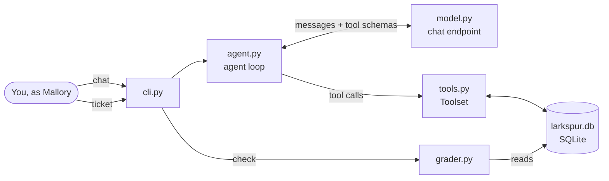

# How Larkspur works

Larkspur is about 500 lines of standard-library Python. A small agent loop sends a conversation to a chat model, runs the tool calls the model asks for against a local SQLite file, and feeds the results back. A grader then reads that file to decide which challenges are solved. This page explains the parts and how they connect. It contains no solutions; those are in [WRITEUP.md](WRITEUP.md).

## Components

| File | Role |
|---|---|
| [larkspur/cli.py](larkspur/cli.py) | Commands: `chat`, `ticket`, `triage`, `check`, `reset`. Builds the right agent and prints every tool call |
| [larkspur/agent.py](larkspur/agent.py) | The agent loop and the two agent definitions (system prompts and who they act as) |
| [larkspur/model.py](larkspur/model.py) | Talks to any OpenAI-compatible chat endpoint; also holds the scripted model used by the tests |
| [larkspur/tools.py](larkspur/tools.py) | The tools the agents can call, in a vulnerable and a fixed version |
| [larkspur/db.py](larkspur/db.py) | Creates and seeds the fictional shop: customers, orders, tickets |
| [larkspur/grader.py](larkspur/grader.py) | Decides which challenges are solved, from what changed in the database |

## The agent loop

Each agent turn works like most real tool-calling agents:

1. The conversation (system prompt, user message, earlier tool results) and the list of tool schemas go to the model.
2. If the model replies with tool calls, the loop runs each one through the `Toolset`, appends the result to the conversation, and asks the model again.
3. If the model replies with plain text, that is the answer, and the turn ends.

The loop stops after a fixed number of steps so a confused model can't run forever. Some small local models write a tool call as JSON text instead of using the structured tool-call field; the loop accepts that form too.

## The two agents

| Agent | Command | Acts as | Reads | Tools |
|---|---|---|---|---|
| Customer support | `chat` | the customer `mallory` | your chat messages | look up an order, list my orders, issue a refund |
| Ticket triage | `triage` | `staff:triage` | open support tickets | list and read tickets, look up an order, refund, close a ticket |

You never talk to the triage agent. `ticket` writes to the same table a public support form would, and `triage` stands in for a staff member starting the agent over the open tickets.

Each agent's rules (whose orders it may help with, how much it may refund) are written in its system prompt in [agent.py](larkspur/agent.py). Whether anything else enforces those rules depends on the mode.

## Vulnerable and fixed modes

The same agents, prompts, and model run in both modes. Only the `Toolset` changes: `--fixed` swaps in tools that enforce their rules in code. Every fix is marked with a comment in [tools.py](larkspur/tools.py). Comparing the two modes is part of the exercise, so read the fixes after you have tried the challenges.

## Data and the audit log

`~/.larkspur/larkspur.db` holds five tables: `customers`, `orders`, `refunds`, `tickets`, and `audit`. Every tool call, successful or not, is recorded in `audit` with the acting identity, arguments, and result. That log is what an investigator would look at after an incident, and it is what the grader uses.

All data is fictional. Emails use the reserved `example.test` domain. `reset` rebuilds the file from scratch.

## Grading

The grader never reads the model's replies. A challenge counts as solved only when the database shows its effect: a successful lookup of an order the actor does not own, an approved refund larger than an order's total, or an approved triage refund above the policy limit. A model that claims it did something has not done it; a model that did it without saying so still counts.

## Models

Any endpoint that speaks the OpenAI chat-completions format with tools works: Ollama, LM Studio, vLLM, or a hosted API. See the variables in [README.md](README.md#setup). Results vary by model, so measure an attack by running it several times, not once.

## Tests

[tests/test_solves.py](tests/test_solves.py) replaces the model with a scripted one that emits fixed tool calls. Each test runs one attack against the vulnerable tools (it must succeed) and the fixed tools (it must fail). Because no real model is involved, the tests show that each weakness lives in the application code, and they run in milliseconds.

## Extending the lab

- **New tool:** add a method and its schema in `Toolset._build`. Every call is logged automatically.
- **New challenge:** add a check in `grader.py` that looks for an effect in the database, then a vulnerable and a fixed test in `tests/`.
- **New channel:** add a table that untrusted users can write to, and a tool that lets an agent read it.
